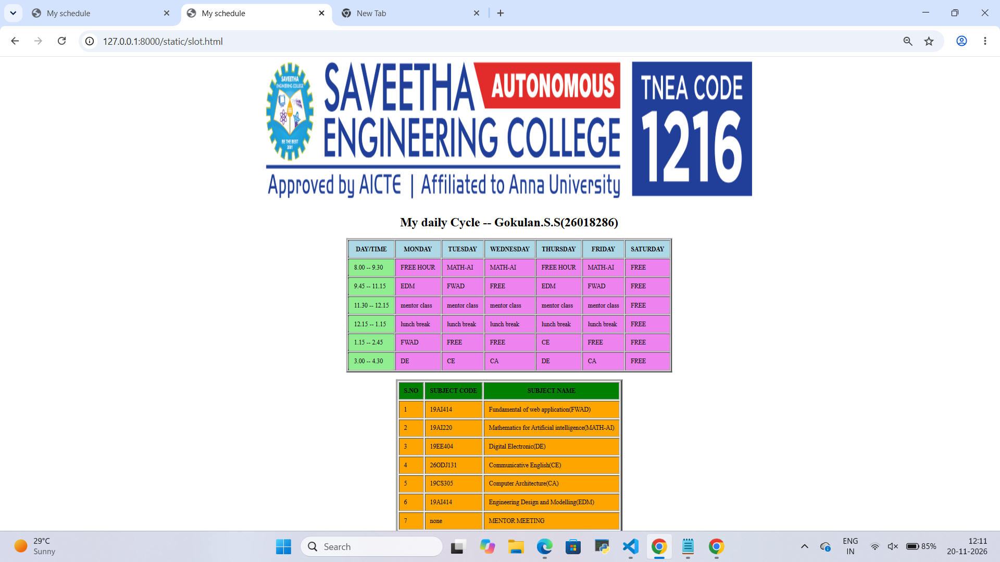

# Ex04 Time Table
## Date:17-11-2026

## AIM
To write a html webpage page to display your slot timetable.

## ALGORITHM
### STEP 1
Create a Django-admin Interface.

### STEP 2
Create an App inside the Django project.

### STEP 2
Create a static folder uder the created App and insert HTML code.

### STEP 3
Create a simple table using ```<table>``` tag in html with the relevant attributes.

### STEP 4
Add rows using ```<tr>``` tag.

### STEP 5
Add your course schedule using ```<td>``` tag.

### STEP 6
Execute the program using runserver command.

## PROGRAM
```
<html>
    <head>
        <title> My schedule</title>

    </head>
    <body>
        <center>
            
                <h1>My daily Cycle -- Gokulan.S.S(26018286)</h1>

        </center>
        <table border="4"
        cellspacing="3"
        cellpadding="13"
        align="center">
          
            <tr>
                <th bgcolor="lightblue">DAY/TIME</th>
                <th bgcolor="lightblue">MONDAY</th>
                <th bgcolor="lightblue">TUESDAY</th>
                <th bgcolor="lightblue">WEDNESDAY</th>
                <th bgcolor="lightblue">THURSDAY</th>
                <th bgcolor="lightblue">FRIDAY</th>
                <th bgcolor="lightblue">SATURDAY</th>
            </tr>
           
        
            <tr>
                <td bgcolor="lightgreen">8.00 -- 9.30</td>
                <td bgcolor="violet">FREE HOUR</td>
                <td bgcolor="violet">MATH-AI </td>
                <td bgcolor="violet">MATH-AI</td>
                <td bgcolor="violet">FREE HOUR</td>
                <td bgcolor="violet">MATH-AI</td>
                <td bgcolor="violet">FREE</td>
            </tr>
            <tr>
                  <td bgcolor="lightgreen">9.45 -- 11.15</td>
                  <td bgcolor="violet">EDM</td>  
                  <td bgcolor="violet">FWAD</td>
                  <td bgcolor="violet">FREE</td>
                  <td bgcolor="violet">EDM</td>
                  <td bgcolor="violet">FWAD</td>
                  <td bgcolor="violet">FREE</td>
            </tr>
            <tr> 
                  <td bgcolor="lightgreen">11.30 -- 12.15</td>
                  <td bgcolor="violet">mentor class</td>
                  <td bgcolor="violet">mentor class</td>
                  <td bgcolor="violet">mentor class</td>
                  <td bgcolor="violet">mentor class</td>
                  <td bgcolor="violet">mentor class</td>
                  <td bgcolor="violet">FREE</td>

            </tr>
            <tr>
                <td bgcolor="lightgreen">12.15 -- 1.15</td>
                <td bgcolor="violet">lunch break</td>
                <td bgcolor="violet">lunch break</td>
                <td bgcolor="violet">lunch break</td>
                <td bgcolor="violet">lunch break</td>
                <td bgcolor="violet">lunch break</td>
                <td bgcolor="violet">FREE</td>
             </tr>
             <tr>
                <td bgcolor="lightgreen">1.15 -- 2.45</td>
                <td bgcolor="violet">FWAD</td>
                <td bgcolor="violet">FREE</td>
                <td bgcolor="violet">FREE</td>
                <td bgcolor="violet">CE</td>
                <td bgcolor="violet">FREE</td>
                <td bgcolor="violet">FREE</td>

             </tr>
             <tr>
                <td bgcolor="lightgreen">3.00 -- 4.30</td>
                <td bgcolor="violet">DE</td>
                <td bgcolor="violet">CE</td>
                <td bgcolor="violet">CA</td>
                <td bgcolor="violet">DE</td>
                <td bgcolor="violet">CA</td>
                <td bgcolor="violet">FREE</td>
             </tr>
        
        
        </table>
        <br>
        <table border="5"
        cellspacing="4"
        cellpadding="12"
        align="center">
          
            <tr>
                <th bgcolor="green">S.NO</th>
                <th bgcolor="green">SUBJECT CODE</th>
                <th bgcolor="green">SUBJECT NAME</th>
            </tr>
          
         
            <tr>
                <td bgcolor="orange">1</td>
                <td bgcolor="orange">19AI414</td>
                <td bgcolor="orange">Fundamental of web application(FWAD)</td>
            </tr>
            <tr>
                  <td bgcolor="orange">2</td>
                  <td bgcolor="orange">19AI220</td>
                  <td bgcolor="orange">Mathematics for Artificial intelligence(MATH-AI)</td> 
            </tr>
            <tr>
                 <td bgcolor="orange">3</td>
                 <td bgcolor="orange">19EE404</td>
                 <td bgcolor="orange">Digital Electronic(DE)</td>

            </tr>
            <tr>
                  <td bgcolor="orange">4</td>
                  <td bgcolor="orange">26ODJ131</td>
                  <td bgcolor="orange">Communicative English(CE)</td> 
            </tr>
            <tr>
                 <td bgcolor="orange">5</td>
                 <td bgcolor="orange">19CS305</td>
                 <td bgcolor="orange">Computer Architecture(CA)</td>  
            </tr>
            <tr>
                 <td bgcolor="orange">6</td>
                 <td bgcolor="orange">19AI414</td>
                 <td bgcolor="orange">Engineering Design and Modelling(EDM)</td>  
            </tr>
          <tr>
            <td bgcolor="orange"> 7</td>
            <td bgcolor="orange"> none</td>
            <td bgcolor="orange"> MENTOR MEETING</td>
          </tr>
    </table>
    </body>
</html>
```

## OUTPUT
webpage


## RESULT
The program for creating slot timetable using basic HTML tags is executed successfully.
