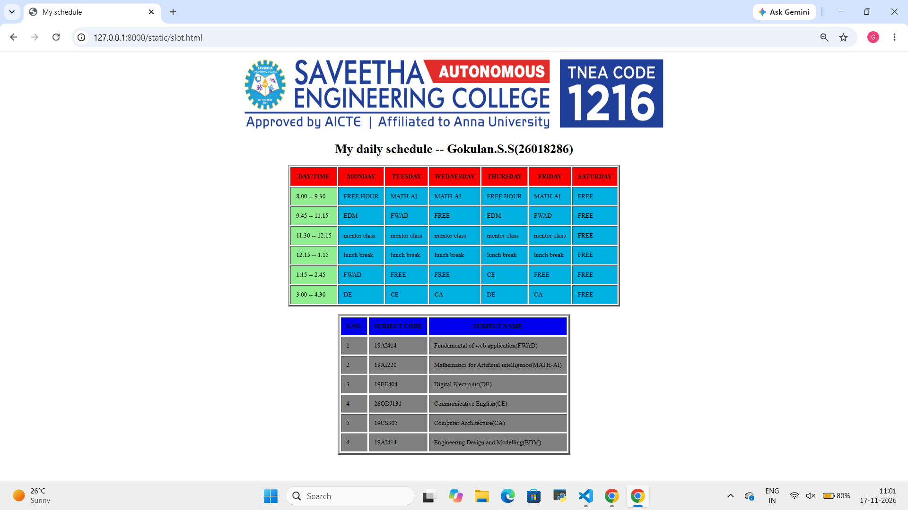

# Ex02 Time Table
## Date:17-11-2026

## AIM
To write a html webpage page to display your slot timetable.

## ALGORITHM
### STEP 1
Create a Django-admin Interface.

### STEP 2
Create an App inside the Django project.

### STEP 2
Create a static folder uder the created App and insert HTML code.

### STEP 3
Create a simple table using ```<table>``` tag in html with the relevant attributes.

### STEP 4
Add rows using ```<tr>``` tag.

### STEP 5
Add your course schedule using ```<td>``` tag.

### STEP 6
Execute the program using runserver command.

## PROGRAM
```
<html>
    <head>
        <title> My schedule</title>

    </head>
    <body>
        <center>
            
                <h1>My daily schedule -- Gokulan.S.S(26018286)</h1>

        </center>
        <table border="4"
        cellspacing="3"
        cellpadding="13"
        align="center">
        <thead bgcolor="red">
            <tr>
                <th>DAY/TIME</th>
                <th>MONDAY</th>
                <th>TUESDAY</th>
                <th>WEDNESDAY</th>
                <th>THURSDAY</th>
                <th>FRIDAY</th>
                <th>SATURDAY</th>
            </tr>
        </thead>
        <tbody bgcolor="sky blue">
            <tr>
                <td bgcolor="lightgreen">8.00 -- 9.30</td>
                <td>FREE HOUR</td>
                <td>MATH-AI </td>
                <td>MATH-AI</td>
                <td>FREE HOUR</td>
                <td>MATH-AI</td>
                <td>FREE</td>
            </tr>
            <tr>
                  <td bgcolor="lightgreen">9.45 -- 11.15</td>
                  <td>EDM</td>  
                  <td>FWAD</td>
                  <td>FREE</td>
                  <td>EDM</td>
                  <td>FWAD</td>
                  <td>FREE</td>
            </tr>
            <tr> 
                  <td bgcolor="lightgreen">11.30 -- 12.15</td>
                  <td>mentor class</td>
                  <td>mentor class</td>
                  <td>mentor class</td>
                  <td>mentor class</td>
                  <td>mentor class</td>
                  <td>FREE</td>

            </tr>
            <tr>
                <td bgcolor="lightgreen">12.15 -- 1.15</td>
                <td>lunch break</td>
                <td>lunch break</td>
                <td>lunch break</td>
                <td>lunch break</td>
                <td>lunch break</td>
                <td>FREE</td>
             </tr>
             <tr>
                <td bgcolor="lightgreen">1.15 -- 2.45</td>
                <td>FWAD</td>
                <td>FREE</td>
                <td>FREE</td>
                <td>CE</td>
                <td>FREE</td>
                <td>FREE</td>

             </tr>
             <tr>
                <td bgcolor="lightgreen">3.00 -- 4.30</td>
                <td>DE</td>
                <td>CE</td>
                <td>CA</td>
                <td>DE</td>
                <td>CA</td>
                <td>FREE</td>
             </tr>
        
        </tbody>
        </table>
        <br>
        <table border="5"
        cellspacing="4"
        cellpadding="12"
        align="center">
          <thead bgcolor="light green">
            <tr>
                <th>S.NO.</th>
                <th>SUBJECT CODE</th>
                <th>SUBJECT NAME</th>
            </tr>
          </thead>
          <tbody bgcolor="grey">
            <tr>
                <td>1</td>
                <td>19AI414</td>
                <td>Fundamental of web application(FWAD)</td>
            </tr>
            <tr>
                  <td>2</td>
                  <td>19AI220</td>
                  <td>Mathematics for Artificial intelligence(MATH-AI)</td> 
            </tr>
            <tr>
                 <td>3</td>
                 <td>19EE404</td>
                 <td>Digital Electronic(DE)</td>

            </tr>
            <tr>
                  <td>4</td>
                  <td>26ODJ131</td>
                  <td>Communicative English(CE)</td> 
            </tr>
            <tr>
                 <td>5</td>
                 <td>19CS305</td>
                 <td>Computer Architecture(CA)</td>  
            </tr>
            <tr>
                 <td>6</td>
                 <td>19AI414</td>
                 <td>Engineering Design and Modelling(EDM)</td>  
            </tr>
          </tbody>
    </table>
    </body>
</html>
```

## OUTPUT
webpage


## RESULT
The program for creating slot timetable using basic HTML tags is executed successfully.
